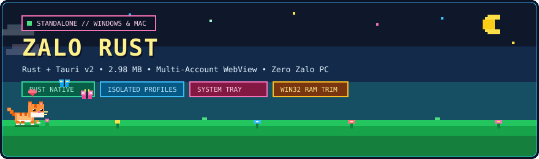

<div align="center">



<br />

[](#)
[](https://github.com/xomno01/zalo-rust/releases/latest/download/ZaloRust-v1.1.0-win64.exe)
[](#)
[](#)
[-A855F7?style=for-the-badge)](#)

**Zalo Rust — Ứng dụng Zalo Desktop độc lập viết lại hoàn toàn bằng Rust + Tauri v2, siêu nhẹ ~3 MB, không cần cài Zalo PC gốc, mở nhiều tài khoản song song trên cả Windows & macOS.**

[⬇️ Tải Ngay v1.1.0](#-tải-về--chạy-ngay-1-click) • [✨ Tính Năng Đầy Đủ](#-kiểm-tra-tất-tần-tật-tính-năng) • [⚡ Kiểm Chứng Xung Đột Multi-Zalo](#-kiểm-tra-xung-đột-khi-dùng-nhiều-zalo-cùng-lúc) • [🛠 Build Từ Source](#-phát-triển--build-từ-source)

</div>

---

## ⬇️ Tải Về & Chạy Ngay (1-Click)

> **100% Độc Lập:** Không cần cài Zalo PC gốc, không cần Node.js hay Electron. Chỉ tải 1 file duy nhất về là chạy.

| Nền tảng | File tải về | Dung lượng | Link |
| :--- | :--- | :--- | :--- |
| **Windows 10/11 (64-bit)** | `ZaloRust-v1.1.0-win64.exe` | **`2.98 MB`** | [-22C55E?style=for-the-badge&logo=windows&logoColor=white)](https://github.com/xomno01/zalo-rust/releases/latest/download/ZaloRust-v1.1.0-win64.exe) |
| **Tất cả phiên bản / macOS CI** | Trang Releases (`.exe`, `.msi`, `.dmg`) | — | [](https://github.com/xomno01/zalo-rust/releases/latest) |

- **Lưu ý Windows SmartScreen:** Do file Rust mã nguồn mở chưa mua chữ ký số thương mại, nếu Windows hiện cảnh báo *"Windows protected your PC"*, bấm **More info** → **Run anyway**.

<div align="center">
  
</div>

---

## ✨ Kiểm Tra Tất Tần Tật Tính Năng

1. **Ứng dụng độc lập hoàn toàn (`2.98 MB`):**
   - Viết bằng **Rust + Tauri v2**, dùng thẳng WebView gốc của hệ điều hành (`Edge WebView2` trên Windows, `WKWebView` trên macOS).
   - Host Rust chỉ tốn **`~7.6 MB` Private Commit** (`~40 MB` Working Set), không gánh nhân Chromium/Node.js `738 MB` như Zalo Electron.
2. **Quản lý & Mở nhiều tài khoản Zalo song song:**
   - Tạo không giới hạn hồ sơ tài khoản (`+ Thêm tài khoản`), lưu cấu hình trong `profiles.json` với kiểm tra ID chống path-traversal (`[a-z0-9_-]{1,32}`).
   - **Windows/Linux:** Mỗi tài khoản được cấp 1 thư mục dữ liệu WebView2 tách biệt (`%APPDATA%\com.xomno01.zalorust\profiles\<id>`).
   - **macOS:** Mỗi tài khoản dùng 1 `data_store_identifier` UUID riêng trên WKWebView.
   - Bật **Tự mở** (`auto_open`) để tự động bật sẵn các nick quan trọng khi mở app.
3. **Single-Instance thông minh (`v1.0.1` + `v1.0.2`):**
   - Bấm đúp icon Desktop nhiều lần sẽ không sinh tiến trình trùng làm lỗi khóa `EBWebView`, mà tự đưa cửa sổ chính lên foreground (hoặc tự tạo lại cửa sổ nếu trước đó bị đóng).
   - Hỗ trợ gọi mở thẳng 1 profile từ dòng lệnh: `ZaloRust.exe --open-profile=default`.
4. **System Tray & Tự thoát sạch:**
   - Menu khay hệ thống tiếng Việt: **Quản lý tài khoản**, **Mở tài khoản mặc định**, **Nén RAM ngay**, **Thoát hoàn toàn**.
   - Khi đang có cửa sổ Zalo chat mở, bấm `X` ở trình quản lý sẽ thu gọn xuống khay hệ thống kèm nén RAM; nếu không có cửa sổ chat nào đang mở thì bấm `X` sẽ thoát app sạch sẽ.
5. **Chủ động nén RAM (`EmptyWorkingSet`):**
   - Nút **Nén RAM** gọi Win32 `EmptyWorkingSet` ngay lập tức và hiển thị số MB đang dùng theo thời gian thực.
6. **Bảo mật điều hướng (Navigation Guard):**
   - Chỉ cho phép mở trong app các domain chính chủ Zalo (`zalo.me`, `zaloapp.com`, `zing.vn`, `zadn.vn`, `zdn.vn`). Mọi link web ngoài người khác gửi trong chat đều tự động mở bằng trình duyệt mặc định của máy.
7. **Cross-Platform CI/CD (Windows + macOS):**
   - Workflow [.github/workflows/release.yml](.github/workflows/release.yml) tự động build song song trên `windows-latest` và `macos-latest` (`universal-apple-darwin` cho cả Intel & Apple Silicon).

---

## ⚡ Kiểm Tra Xung Đột Khi Dùng Nhiều Zalo Cùng Lúc

Bảng đánh giá chi tiết khi chạy song song **nhiều tài khoản trong `Zalo Rust`** hoặc chạy chung với **Zalo PC gốc / Zalo Ultra Client**:

| Hạng mục kiểm tra | Có xung đột không? | Giải thích kỹ thuật & Lưu ý thực tế |
| :--- | :--- | :--- |
| **1. Gọi điện (Voice / Video Call)** | **KHÔNG xung đột pipe hệ thống** | App dùng **WebRTC của WebView2/WKWebView**, **không dùng `ZaloCall.exe` hay Named Pipe (`PipeZCallRecv`/`PipeZCallSend`)**, nên không bao giờ đụng pipe với Zalo PC gốc hoặc giữa nhiều cửa sổ. *(Lưu ý tự nhiên của máy tính: nếu 2 nick đổ chuông hoặc nói chuyện cùng 1 giây thì loa/mic sẽ phát chồng lên nhau).* |
| **2. Nhắn tin qua lại (Đi & Đến)** | **KHÔNG xung đột** | Mỗi tài khoản chạy trên cookie, IndexedDB và WebSocket riêng biệt trong `profiles/<id>`, gửi nhận tin nhắn song song hoàn toàn độc lập *(miễn là mỗi cửa sổ đăng nhập 1 SĐT/tài khoản Zalo khác nhau; nếu 2 nơi mở trùng 1 nick thì server Zalo sẽ tự đá phiên cũ theo luật 1 PC/Web của VNG).* |
| **3. Thông báo đến & đi** | **KHÔNG xung đột — có 2 lưu ý nhỏ** | - **Thông báo Web / Âm thanh:** Mỗi cửa sổ giữ WebSocket riêng nên **vẫn nhảy badge tin nhắn mới, title và phát chuông báo bình thường**.<br>- **Desktop Toast Notification:** Cần bật quyền Thông báo cho `chat.zalo.me` trong cửa sổ chat lần đầu. Trên Windows, khi bấm **Thoát hoàn toàn** (đóng cửa sổ `zalo-*`), app không chạy background service như Zalo PC nên sẽ không nhận thông báo; hãy **thu nhỏ hoặc bấm `X` ẩn xuống System Tray** để nhận thông báo liên tục. |
| **4. Chớp chuột xanh (`ZaloCap.exe`)** | **KHÔNG bị 100%** | Không gọi `ZaloCap.exe`, hoàn toàn miễn nhiễm lỗi chớp con trỏ chuột. *(Dùng `Win+Shift+S` trên Windows hoặc `Cmd+Shift+4` trên Mac để chụp ảnh rồi `Ctrl+V` dán thẳng vào chat).* |
| **5. Lưu phiên & QR đăng nhập** | **Cô lập riêng từng nick** | Mỗi tài khoản giữ cookie & phiên riêng trong `EBWebView` của `profiles/<id>`, không ghi đè lẫn nhau. |

<div align="center">
  
</div>

---

## 🛠 Phát Triển & Build Từ Source

- **Yêu cầu:** [Rust & Cargo](https://rustup.rs/) (stable), WebView2 (có sẵn Windows 10/11) hoặc Xcode Command Line Tools (macOS). Không cần Node.js/npm!

```bash
# Chạy unit tests (7/7 pass: profiles, URL allowlist, CLI args)
cd src-tauri
cargo test

# Build bản phát hành tối ưu dung lượng (~2.98 MB)
cargo build --release
```

## 📁 Cấu Trúc Thư Mục

```text
zalo-rust/
├── assets/
│   ├── cute-cat-butterfly-banner.svg   # Banner mèo pixel chạy vờn bướm
│   └── cute-cat-divider.svg            # Dải ngăn cách mèo trắng vờn bướm
├── src-tauri/
│   ├── src/
│   │   ├── lib.rs                      # Single-instance, IPC commands, logger
│   │   ├── main.rs                     # Entrypoint Windows GUI
│   │   ├── profiles.rs                 # Quản lý & cô lập hồ sơ tài khoản
│   │   ├── tray.rs                     # System Tray & phục hồi cửa sổ
│   │   └── windows.rs                  # WebView2/WKWebView isolation, nav guard, RAM trim
│   ├── capabilities/default.json
│   ├── Cargo.toml
│   └── tauri.conf.json
├── ui/                                 # Giao diện HTML/CSS/JS thuần
└── .github/workflows/release.yml       # Auto-build Windows & macOS
```
